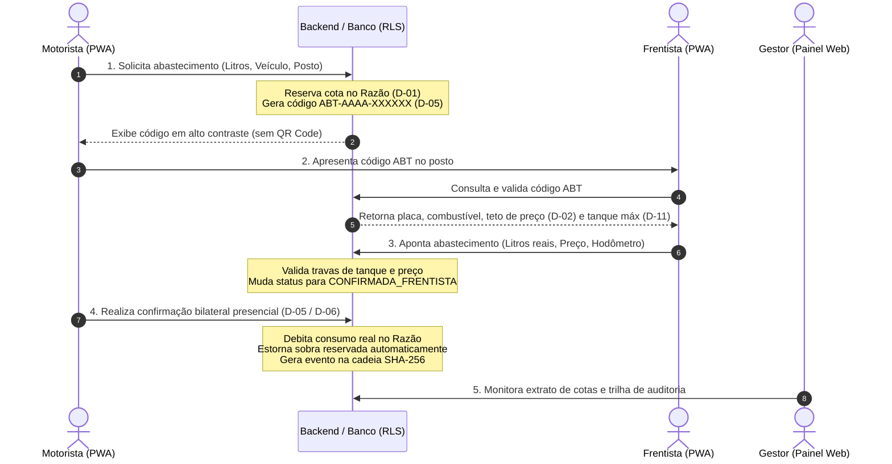

# 📖 Manual de Operação por Perfil de Usuário — GestFrota

Manual operacional direto e objetivo do **GestFrota**, detalhando o fluxo de negócio, as operações de cada função e as instruções práticas para cada perfil de usuário: **Gestor Municipal**, **Condutor / Motorista** e **Frentista de Posto Credenciado**.

---

## 🧭 1. Visão Geral do Ciclo de Combustível

O GestFrota substitui requisições em papel e cartões magnéticos tradicionais por um **ciclo bilateral digital e estritamente auditado**, composto por 4 etapas encadeadas:



---

## 🔒 Invariantes e Regras Críticas que Regem o Sistema

1. **Razão de Cotas Imutável (D-01):** Não existe edição direta de saldo. Toda movimentação é registrada como lançamento contábil (Reserva, Consumo ou Estorno). O saldo nunca pode ser negativo (`CHECK (saldo >= 0)`).
2. **Preço Teto Licitatório (D-02):** O posto nunca pode cobrar um centavo acima do preço unitário registrado no contrato vigente com o município.
3. **Código de Uso Único ABT (D-05):** Código alfanumérico no formato `ABT-AAAA-XXXXXX`, válido por 60 minutos. Não há reuso.
4. **Capacidade do Tanque e Hodômetro (D-11):** O volume abastecido não pode superar a capacidade física do tanque do veículo. O hodômetro deve ser estritamente crescente.
5. **Estrita Proibição de QR Codes:** Nenhum código visual QR Code é gerado ou aceito no sistema (Seção 2 da especificação), prevenindo fraudes de leitura remota ou captura de tela de terceiros.
6. **Credencial Funcional (D-31):** A credencial do condutor comprova apenas o vínculo no sistema de frotas e estampa o aviso legal expresso de que **NÃO substitui a CNH**.
7. **Logout Seguro com Confirmação:** O encerramento de sessão em qualquer aplicação sempre exige confirmação em modal, prevenindo deslogamento acidental durante a operação.

---

## 🏢 2. Manual do Gestor Municipal (Painel de Gestão Web)

**Aplicação:** `apps/gestao`  
**Acesso:** [http://localhost:5173](http://localhost:5173) (ou endereço em produção)  
**Perfil:** `GESTOR_GERAL` ou `ADMIN_GERAL`  
**Credencial de Teste:** `admin@demo.gov.br` / `SenhaForte123!`

```
┌────────────────────────────────────────────────────────┐
│  GestFrota — Painel de Gestão                          │
├──────────────┬─────────────────────────────────────────┤
│ [📊 Painel]  │ Indicadores executivos de consumo       │
│ [🚗 Frota]   │ Cadastro de veículos e travas de tanque │
│ [👤 Equipe]  │ Condutores e controle de CNH            │
│ [📄 Contrato]│ Postos credenciados e preços vigentes   │
│ [⛽ Cotas]   │ Extrato do Razão Imutável do Veículo    │
│ [🛡️ Auditor] │ Trilha encadeada SHA-256 e Âncoras      │
└──────────────┴─────────────────────────────────────────┘
```

### Operação 2.1: Consultar e Cadastrar Veículos da Frota
1. No menu lateral, acesse **Veículos**.
2. Visualize a lista de veículos ativos do município com: Placa, Modelo, Secretaria vinculada, Tipo de medidor e **Capacidade do Tanque (Litros)**.
3. **Ao cadastrar um veículo:**
   * A capacidade do tanque é um campo **obrigatório**. Essa informação é a trava de segurança física usada pela API para barrar abastecimentos com litragens fraudulentas na ponta.

### Operação 2.2: Gerenciar Motoristas e CNH
1. Acesse **Motoristas**.
2. Consulte os condutores autorizados, número e categoria da CNH e a data de validade do documento.
3. Condutores com CNH vencida ou com bloqueio administrativo não conseguem emitir novas autorizações no aplicativo de campo.

### Operação 2.3: Fiscalizar Contratos e Preços de Combustível (D-02)
1. Acesse **Contratos**.
2. Verifique o número do contrato, fornecedor/posto credenciado, período de vigência e itens licitados.
3. **Ponto Crítico:** Confira o valor do **Preço Vigente (R$/L)** registrado para cada produto (Gasolina Comum, Diesel S-10, Etanol). É esse valor que atua como **teto máximo** na validação de cada abastecimento efetuado no posto.

### Operação 2.4: Acompanhar o Razão de Cotas Imutável (D-01)
1. Acesse **Cotas**.
2. Selecione o veículo desejado para abrir o **Extrato do Razão Imutável**:
   * **Saldo Disponível (L):** Litragem livre para novos abastecimentos no mês corrente.
   * **Saldo Reservado (L):** Litragem bloqueada temporariamente por autorizações ABT emitidas que estão aguardando abastecimento na bomba.
   * **Lançamentos Contábeis:** Tabela auditada contendo tipo de movimentação (`RESERVA`, `CONSUMO`, `ESTORNO`, `AJUSTE`), data/hora, saldo anterior e saldo posterior.

### Operação 2.5: Verificar a Integridade da Trilha de Auditoria (SHA-256)
1. Acesse **Auditoria**.
2. Cada ação executada no sistema gera um registro com carimbo de tempo, usuário responsável, tipo de operação e dois hashes criptográficos:
   * `hash_anterior` (aponta para o registro imediatamente precedente).
   * `hash_atual` (calculado sobre os dados da operação + hash anterior).
3. **Âncoras Diárias:** Diariamente à 01:00 da manhã, o Worker gera um selo diário na tabela `auditoria_ancoras`, congelando o estado criptográfico do dia anterior para fiscalização de órgãos de controle (TCE/CGU).

---

## 🚗 3. Manual do Condutor / Motorista (PWA de Campo)

**Aplicação:** `apps/campo`  
**Acesso:** [http://localhost:5174](http://localhost:5174) (no celular ou navegador em modo responsivo)  
**Perfil:** `MOTORISTA`  
**Credencial de Teste:** `motorista@demo.gov.br` / `SenhaForte123!`

```
┌─────────────────────────────────────────┐
│ GestFrota Campo           [Online ●] [⎋]│
├─────────────────────────────────────────┤
│                                         │
│        SOLICITAR ABASTECIMENTO          │
│                                         │
│ Veículo: [ BRA2E19 - Ambulância     ▼ ] │
│ Posto:   [ Posto Central Demo       ▼ ] │
│ Litros:  [ 40                         ] │
│                                         │
│ [ 🚀 Emitir Autorização de Abastecimento]│
│                                         │
├─────────────────────────────────────────┤
│   [⛽ Solicitar] [🛡️ Bilateral] [👤 CNH] │
└─────────────────────────────────────────┘
```

### Operação 3.1: Solicitar Abastecimento no Pátio / Em Trânsito
1. Faça login no aplicativo de campo com seu e-mail institucional.
2. Na aba **Solicitar**:
   * Selecione o veículo que você está conduzindo (ex: `BRA2E19`).
   * Selecione o posto credenciado de destino.
   * Selecione o combustível correto e a quantidade de litros estimada necessária.
3. Toque em **"Emitir Autorização de Abastecimento"**:
   * O sistema debita a reserva no razão de cotas instantaneamente.
   * Um card de alto contraste exibe o código único: **`ABT-2026-XXXXXX`**.
   * O card informa a validade limite (60 minutos).
4. **Sem QR Code:** Mostre o código alfanumérico diretamente na tela para o frentista no posto (ou dite os 6 caracteres finais).

### Operação 3.2: Confirmação Bilateral Presencial (D-05 / D-06)
> [!IMPORTANT]
> **A presença do motorista na bomba é mandatória:** O abastecimento **não** é liquidado enquanto o motorista não realizar a confirmação no próprio aparelho, garantindo que o combustível realmente entrou no veículo público.

1. Após o frentista terminar de abastecer e registrar o apontamento na bomba:
2. No seu aplicativo, acesse a aba **Bilateral**.
3. Confirme o Identificador da Autorização e confira os dados exibidos (litros abastecidos na bomba e hodômetro registrado).
4. Toque em **"Confirmar Abastecimento"**.
5. **Resultado:** O abastecimento é formalmente liquidado. Se você pediu 40 L e abasteceu 38.5 L, o saldo residual de 1.5 L retorna automaticamente para o veículo.

### Operação 3.3: Exibir a Credencial Funcional Digital (D-31)
1. Acesse a aba **Credencial**.
2. A tela exibe seu nome, CPF, vínculo funcional com a Secretaria Municipal e a categoria da CNH registrada.
3. **Aviso Legal:** Observe a tarja de segurança obrigatória que estipula formalmente que a credencial funcional **NÃO substitui a CNH física/digital perante agentes de trânsito**.

### Operação 3.4: Operação em Áreas sem Sinal de Celular (Modo Offline)
1. Se você estiver em uma zona rural sem cobertura de celular, o aplicativo continuará funcionando normalmente através do banco de dados local **IndexedDB**.
2. O topo do aplicativo exibirá a pílula amarela **"Offline"** e indicará as ações pendentes na fila.
3. Assim que seu aparelho retomar a conexão (ou conectar no Wi-Fi do posto), o aplicativo **sincroniza a fila automaticamente em segundo plano**, sem necessidade de redigitar nada.

---

## ⛽ 4. Manual do Frentista do Posto Credenciado (PWA de Campo)

**Aplicação:** `apps/campo`  
**Acesso:** [http://localhost:5174](http://localhost:5174) (no celular ou maquininha Android do posto)  
**Perfil:** `FRENTISTA`  
**Credencial de Teste:** `frentista@demo.gov.br` / `SenhaForte123!`

```
┌─────────────────────────────────────────┐
│ GestFrota Campo           [Online ●] [⎋]│
├─────────────────────────────────────────┤
│                                         │
│           VALIDAR AUTORIZAÇÃO           │
│                                         │
│ Código ABT:                             │
│ [ ABT-2026-F98A1B                     ] │
│                                         │
│ [ 🔍 Consultar Autorização            ] │
│                                         │
├─────────────────────────────────────────┤
│        [🔍 Validar ABT] [⛽ Abastecer]   │
└─────────────────────────────────────────┘
```

### Operação 4.1: Consultar e Validar o Código ABT do Condutor
1. Quando o motorista da prefeitura chegar à pista do posto, solicite o código ABT exibido na tela do celular dele.
2. Na aba **Validar ABT**, digite o código (ex: `ABT-2026-XXXXXX`) e toque em **Consultar**.
3. O sistema valida na hora e exibe a ficha completa:
   * **Placa e Modelo do Veículo:** Verifique se a placa confere com o veículo parado na bomba.
   * **Combustível Autorizado:** Não forneça combustível diferente do autorizado (ex: Diesel S-10).
   * **Capacidade Máxima do Tanque (D-11):** Informa a trava física do veículo (ex: 60 L).
   * **Preço Máximo Licitatório (D-02):** Exibe o teto contratual que não pode ser ultrapassado.
4. Toque no botão verde: **"Prosseguir para Registro de Abastecimento"**.

### Operação 4.2: Registrar o Abastecimento na Bomba
1. Na tela **Registrar Abastecimento**:
   * O código da autorização já virá preenchido.
   * **Litros na Bomba:** Digite exatamente a litragem que constou no visor da bomba (ex: `38.5` L).
   * **Preço Unitário:** Digite o preço praticado por litro (ex: `5.850`).
   * **Leitura do Painel (Hodômetro / Horímetro):** Olhe no painel do veículo e informe a quilometragem atual (ex: `125400`).
2. O sistema calcula e exibe em tempo real o **Valor Total** (R$).
3. **Travas de Segurança Automáticas:**
   * Se os litros digitados forem maiores que a capacidade do tanque: o sistema **bloqueia** o envio com base na regra D-11.
   * Se o preço digitado for maior que o preço licitado do contrato: o sistema **bloqueia** com base na regra D-02.
4. Toque em **"Confirmar e Finalizar Bomba"**.

### Operação 4.3: Conclusão do Atendimento
1. A tela exibirá a confirmação de que o abastecimento foi registrado pelo frentista com sucesso.
2. **Oriente o condutor:** Avise ao motorista que ele deve abrir a aba **Bilateral** no celular dele para dar o aceite final presencial antes de liberar a saída da pista.

---

## 📊 5. Matriz de Perfis e Permissões do Sistema

| Funcionalidade / Operação | Gestor Geral | Gestor Secretaria | Motorista | Frentista |
|---|:---:|:---:|:---:|:---:|
| Visualizar Dashboard e Frotas | ✅ | ✅ | ❌ | ❌ |
| Cadastrar Veículos e Contratos | ✅ | ❌ | ❌ | ❌ |
| Consultar Razão de Cotas Imutável | ✅ | ✅ | ❌ | ❌ |
| Consultar Trilha de Auditoria SHA-256 | ✅ | ❌ | ❌ | ❌ |
| Solicitar Abastecimento (Gerar ABT) | ✅ | ❌ | ✅ | ❌ |
| Visualizar Credencial Funcional | ❌ | ❌ | ✅ | ❌ |
| Validar Código ABT na Pista | ✅ | ❌ | ❌ | ✅ |
| Apontar Litragem e Hodômetro na Bomba | ✅ | ❌ | ❌ | ✅ |
| Realizar Confirmação Bilateral | ✅ | ❌ | ✅ | ❌ |
| Operar com Resiliência Offline (Dexie) | ❌ | ❌ | ✅ | ✅ |
